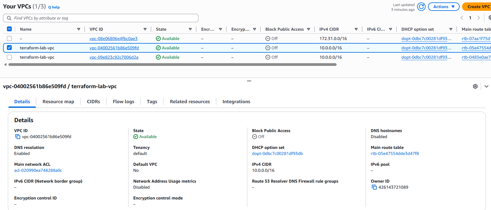
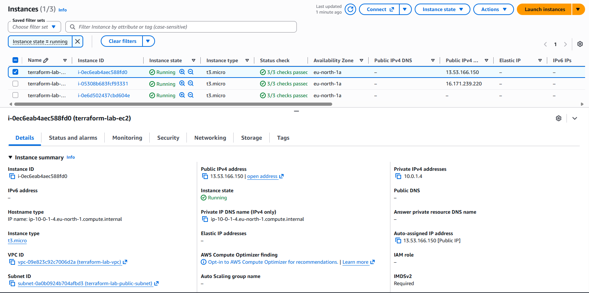
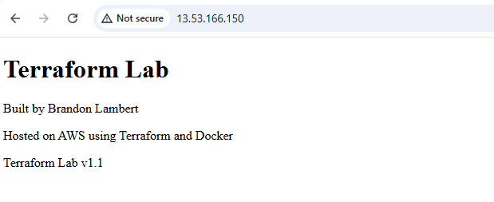

# Terraform Lab

Infrastructure as Code (IaC) learning project using Terraform and AWS.

## Overview

This repository documents my journey learning Terraform and AWS as part of my transition into DevOps and Cloud Engineering.

## Objectives

- Learn Terraform fundamentals
- Understand Infrastructure as Code (IaC)
- Provision AWS resources using Terraform
- Build reusable infrastructure using modules
- Learn state management and best practices

## Current Progress

### Completed

- Terraform installed and configured
- AWS CLI configured
- GitHub repository created
- Terraform modules created
- GitHub Actions workflow added
- VPC deployed
- Public subnet deployed
- Internet Gateway deployed
- Route table deployed
- Route table association configured
- Security Group configured
- EC2 instance deployed
- Nginx web server deployed
- Public website accessible

### Lessons Learned

- Terraform variables
- Terraform outputs
- Terraform locals
- Terraform modules
- Remote state management
- AWS networking fundamentals
- Security Groups
- EC2 provisioning
- Docker image creation
- GitHub Container Registry (GHCR)
- GitHub Actions CI/CD
- Infrastructure as Code principles

## Deployed Infrastructure

## Application Deployment

The application is containerized using Docker and stored in GitHub Container Registry (GHCR). The EC2 instance automatically installs Docker, pulls the latest image, and deploys the container during provisioning.

### Container Platform

- Docker installed automatically using Terraform user_data
- Custom Docker image created
- Image pushed to GitHub Container Registry (GHCR)
- EC2 instance pulls container image automatically
- Container deployed automatically on instance creation

### Registry

- GitHub Container Registry (GHCR)

Image: `ghcr.io/blambert87/terraform-lab-web:latest`

### Networking

- Custom VPC (10.0.0.0/16)
- Public subnet
- Internet Gateway
- Route Table
- Security Group
- Public EC2 instance

### Security

- Security Group

### Compute

- EC2 Instance

### Storage

- S3 Bucket

### Application

- Nginx Web Server

## Architecture

```text
Internet
    │
Internet Gateway
    │
Route Table
    │
Public Subnet
    │
EC2 Instance
    │
Nginx Web ServerGitHub
    │
    ▼
GitHub Container Registry (GHCR)
    │
    ▼
Terraform
    │
    ▼
AWS EC2
    │
    ▼
Docker
    │
    ▼
Custom Website
```

## Project Structure

```text
terraform-lab/
├── README.md
├── provider.tf
├── main.tf
├── networking.tf
├── security.tf
├── compute.tf
├── variables.tf
├── outputs.tf
├── terraform.tfvars
└── .gitignore
```

## Terraform Workflow

```bash
terraform init
terraform fmt
terraform validate
terraform plan
terraform apply
terraform destroy
```

## Key Features

- Infrastructure managed with Terraform
- Automated AWS deployment
- Custom Docker container
- GitHub Container Registry integration
- Automated container startup using EC2 user_data
- Publicly accessible web application
- Version controlled through GitHub
- CI/CD workflow using GitHub Actions

## Technologies

- Terraform
- AWS EC2
- AWS VPC
- AWS IAM
- Amazon Linux 2023
- Docker
- GitHub Container Registry (GHCR)
- GitHub Actions
- Git
- Linux

## Results

This project successfully demonstrates Infrastructure as Code using Terraform and AWS.

Provisioned resources include:

- VPC
- Public Subnet
- Internet Gateway
- Route Table
- Security Group
- EC2 Instance
- Docker Runtime
- Custom Docker Image
- GitHub Container Registry Integration
- Public Website

The infrastructure can be recreated consistently using Terraform configuration files and deployed automatically via GitHub Actions

## Milestones

### v1.0

- AWS networking infrastructure
- EC2 instance
- Nginx web server

### v1.1

- Custom Docker image
- GitHub Container Registry
- Automated container deployment on EC2

### v1.2

- S3 remote state backend
- State file stored securely in AWS
- Improved Terraform collaboration workflow

### v1.3

- Implemented S3 remote state backend
- Implemented DynamoDB state locking
- Protected Terraform state against concurrent modifications
- Improved team collaboration capabilities

### v2.1

- Implemented Terraform input variables
- Added configurable environment values
- Parameterised AWS region, VPC CIDR and instance type
- Introduced sensitive variables for secrets management
- Improved configuration flexibility and reusability

## Screenshots

### AWS VPC Created with Terraform



### EC2 Instance Running



### Web Application



## Author

Brandon Lambert

IT Service Desk Analyst transitioning into DevOps and Cloud Engineering.

GitHub: https://github.com/blambert87
